# The Legend of Insper

Jogo de ação e aventura **top-down em 2D**, feito em **Python com [pygame-ce](https://pyga.me/)** para a disciplina de Design de Software do Insper.

O jogador escolhe um herói (**Mago**, **Arqueiro** ou **Bárbaro**) e sobe os **três andares de uma torre** cheia de monstros. No último andar ele enfrenta o chefe, o **Dragão Ancião**. Ganhando ou perdendo, a pontuação da partida vai para um **ranking**.

<p align="center">
  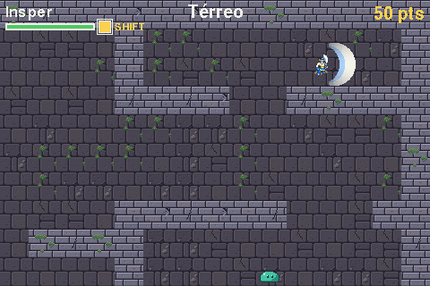
  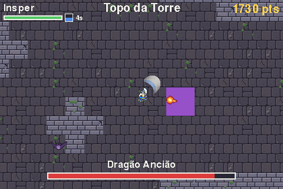
</p>

## Vídeo de demonstração

<p align="center">
  <a href="docs/video/demo.mp4">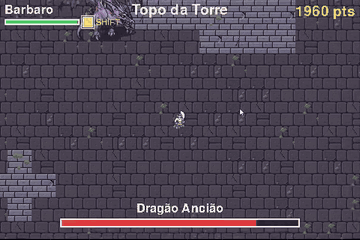</a>
</p>

**[▶️ Assistir ao vídeo completo (2 min)](docs/video/demo.mp4)**: uma partida inteira com o Bárbaro, do nome do jogador até a vitória contra o Dragão Ancião, e depois o Arqueiro e o Mago no Térreo, com a tela de controles, o anel de fogo do Mago e a tela de derrota. A trilha são as músicas do próprio jogo.

## Autores

| | Quem | GitHub | Papel no grupo |
|---|---|---|---|
| 🎨 | **Thiago A. Gomes** | [@Tharlim](https://github.com/Tharlim) | Ideias do jogo e parte artística |
| ⚙️ | **Matheus Assis** | [@matheusma4](https://github.com/matheusma4) | Mecânicas do jogo |
| 🧭 | **Audrei Rossato Filho** | [@audreifilhorossato](https://github.com/audreifilhorossato) | Implementação e organização do projeto |

O que cada um fez está em [Quem fez o quê](#quem-fez-o-quê).

## Sumário

- [Vídeo de demonstração](#vídeo-de-demonstração)
- [Como rodar](#como-rodar)
- [Como jogar](#como-jogar)
- [O jogo](#o-jogo)
- [Quem fez o quê](#quem-fez-o-quê)
- [Como o projeto foi feito](#como-o-projeto-foi-feito)
- [Design e rascunhos](#design-e-rascunhos)
- [Histórico](#histórico)
- [Decisões que tomamos](#decisões-que-tomamos)
- [Organização do código](#organização-do-código)
- [Créditos](#créditos)

---

## Como rodar

Requisitos: **Python 3.10 ou mais novo**.

```bash
pip install -r requirements.txt
python src/main.py
```

O arquivo que roda o jogo é o **`src/main.py`**. O jogo abre em tela cheia, com a imagem no meio e tarjas pretas em volta. **F11** alterna entre tela cheia e janela.

## Como jogar

| Onde | Tecla | O que faz |
|---|---|---|
| Tela inicial | letras e números | digitam o nome do jogador |
| | Backspace | apaga |
| | Enter | vai para a escolha de classe |
| Escolha de classe | A / D ou ← / → | trocam a classe |
| | Enter | vai para a tela de controles |
| | Esc | volta para a tela inicial |
| Controles | Enter ou Espaço | começa a partida |
| | Esc | volta para a escolha de classe |
| Jogo | W A S D | andar |
| | Espaço | ataque |
| | Shift esquerdo | especial |
| | Esc | pausa e continua |
| Resultado | Enter | volta para a tela inicial (sozinho depois de 20 s) |
| Qualquer tela | F11 | tela cheia ou janela |

**Objetivo:** em cada andar, derrote todos os inimigos para abrir a porta de saída e encoste nela para subir. No Topo da Torre, derrote o Dragão Ancião para vencer. Se a vida do herói acabar, é derrota.

## O jogo

### As telas

| Tela inicial | Escolha de classe |
|---|---|
| 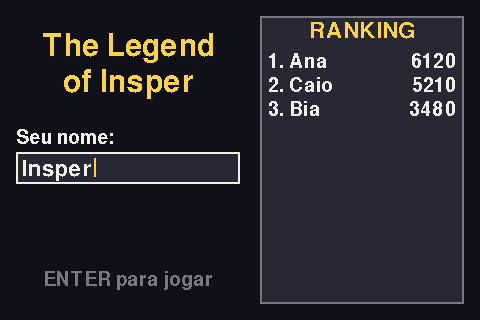 | 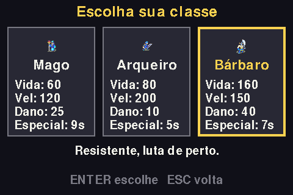 |
| Nome do jogador e as 10 melhores partidas do ranking. | Um cartão por herói, com vida, velocidade, dano e recarga do especial. |

| Controles | Aviso do Dragão |
|---|---|
| 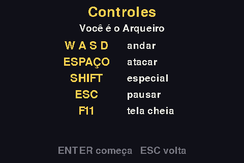 | 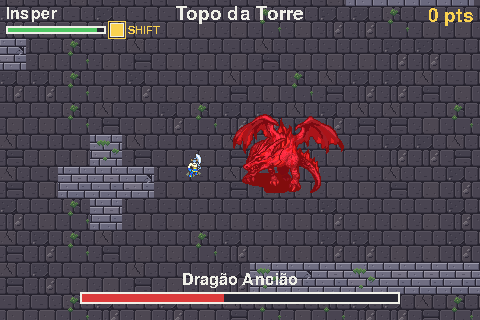 |
| Aparece depois de escolher a classe: mostra as teclas para quem nunca jogou. | Na segunda fase, o Dragão pisca vermelho meio segundo antes de soltar o anel de fogo. |

| Jogo | Pausa |
|---|---|
| 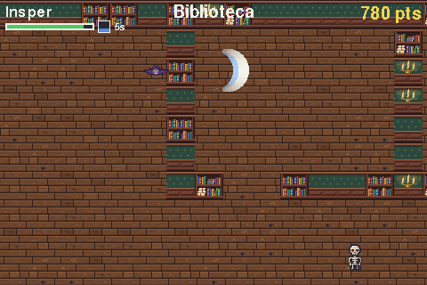 | 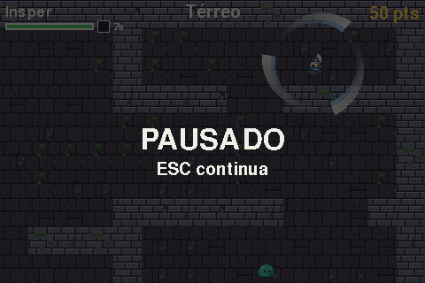 |
| HUD com nome, vida, ícone do especial, andar e pontos. No último andar, a barra de vida do chefe. | Esc escurece a tela e congela tudo, até a música. |

| Especial do Bárbaro | Resultado |
|---|---|
| 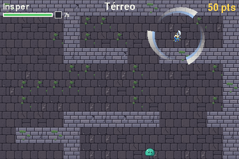 | 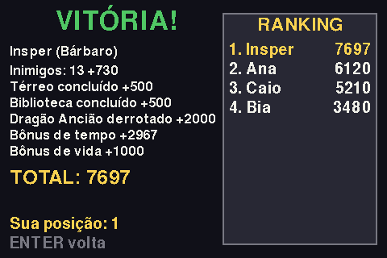 |
| O giro acerta todos em volta e empurra os inimigos. | Vitória ou derrota, o extrato dos pontos e a posição no ranking. |

### Os heróis

| Classe | Vida | Velocidade | Dano | Ataque (Espaço) | Especial (Shift) | Recarga |
|---|---|---|---|---|---|---|
| Mago | 60 | 120 | 25 | bola de fogo lenta e forte | anel com 8 bolas de fogo | 9 s |
| Arqueiro | 80 | 200 | 10 | flecha rápida | 5 flechas em leque | 5 s |
| Bárbaro | 160 | 150 | 40 | machadada logo na frente | giro que acerta todos em volta | 7 s |

Os ataques empurram os inimigos para trás (knockback). Depois de levar dano, o herói fica 0,8 s piscando e não leva dano de novo nesse tempo. O ícone do lado da barra de vida enche enquanto o especial recarrega e fica amarelo, com um "plim", quando ele está pronto.

### Os inimigos

| Inimigo | Vida | Dano ao encostar | Pontos | Jeito |
|---|---|---|---|---|
| Slime | 20 | 10 | 50 | lento; quica no lugar e persegue quando o herói chega perto |
| Esqueleto | 40 | 15 | 80 | mais rápido e percebe o herói de mais longe |
| Morcego | 10 | 5 | 70 | muito rápido; persegue em zigue-zague |
| Dragão Ancião (chefe) | 360 | 25 | 2000 | 2 fases; contorna as paredes até o herói e cospe fogo |

O Dragão tem duas fases. Na primeira, anda devagar e cospe uma bola de fogo quando o herói chega perto. Com metade da vida, entra na segunda fase: anda na velocidade cheia e solta um anel de 12 bolas de fogo a cada 3 segundos. Meio segundo antes de cada anel, ele **pisca vermelho**, para o jogador ter tempo de se afastar. Para chegar ao herói sem ficar preso nas paredes, ele faz uma busca em largura pela grade do mapa.

Cada inimigo comum derrotado tem 30% de chance de deixar uma **poção de vida**, que devolve 25 de vida.

### Os andares

| Andar | Mapa | Inimigos | Cenário |
|---|---|---|---|
| Térreo | 30 × 14 tiles | 4 slimes | pedra |
| Biblioteca | 47 × 17 tiles | 3 slimes, 3 esqueletos e 2 morcegos | madeira e estantes de livros |
| Topo da Torre | 29 × 24 tiles | 2 esqueletos, 1 morcego e o Dragão Ancião | pedra |

Cada andar é maior que a tela, e a câmera segue o herói. Os mapas completos:

<details>
<summary>Ver os três mapas</summary>

**Térreo**

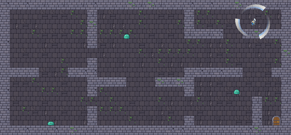

**Biblioteca**

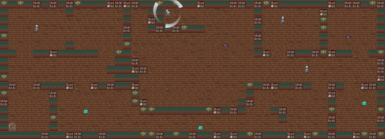

**Topo da Torre**

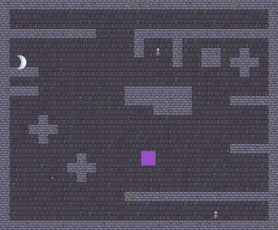

</details>

### Pontuação

- Cada inimigo vale os seus pontos (tabela acima).
- Cada andar concluído vale 500.
- Quem vence ganha dois bônus: até 3000 pelo tempo (zero a partir de 10 minutos) e até 1000 pela vida que sobrou.

A partida é salva no ranking (`src/data/ranking.json`) ganhando ou perdendo.

### Som

São 4 músicas que tocam em loop (menu, torre, chefe e resultado) e 9 efeitos: ataque, acerto, inimigo derrotado, chefe derrotado, herói derrotado, porta, mover e confirmar no menu, e especial pronto.

---

## Quem fez o quê

O objetivo da atividade era **aprender o máximo possível**, então cada um contribuiu de acordo com a sua experiência, e as tarefas foram pensadas para que todos programassem e aprendessem juntos.

### 🎨 Thiago A. Gomes: ideias e parte artística

As ideias do jogo vieram do Thiago, e ele cuidou da parte artística: o visual, os heróis, os andares e o jeito de cada inimigo se mexer.

- Desenhou os **sprites dos três heróis** (`mago.png`, `arqueiro.png`, `barbaro.png`) e deu ao jogo o suporte a sprites.
- Desenhou o **sprite do Dragão Ancião** (`dragao.png`), corrigiu o sprite do Mago e fez o **aviso vermelho** antes do anel de fogo.
- Criou a **tela de controles**, que mostra as teclas antes da partida.
- Fez os **mapas da Biblioteca e do Topo da Torre**.
- Criou a **tela de escolha de classe**, com os cartões dos heróis, e a **tela inicial** com o campo do nome.
- Programou o **zigue-zague do morcego** e as **decisões do Dragão** (as duas fases do chefe).
- Na primeira versão do código, fez a **câmera**, a classe **Entidade**, o **teclado** (WASD, setas e controle), o **carregador de aparências**, o **renderizador do nível** com interpolação e os **ataques** (projétil e golpe do Bárbaro).

### ⚙️ Matheus Assis: mecânicas

O Matheus cuidou das mecânicas, isto é, das regras que fazem o jogo funcionar.

- Criou o **Projetil**, base de todos os ataques à distância, e ligou os **ataques** a cada herói.
- Fez a **Pontuação** e o **Ranking**, que guarda as partidas num arquivo JSON, e o **quadro do ranking** na tela inicial.
- Fez a **caixa de texto** do nome do jogador.
- Fez a **pausa** com Esc e o **quadro de vida** do HUD.
- Ligou os **efeitos sonoros** no combate e nos menus.
- Na primeira versão do código, fez o **leitor de entrada**, os **comandos** (mover, atacar, especial), a **sessão** dos jogadores e o **controlador humano**.

### 🧭 Audrei Rossato Filho: implementação e organização

O Audrei, por ser o programador mais experiente do grupo, acabou entregando mais código. Mas a ideia sempre foi que os outros aprendessem junto, e por isso ele atuou como **organizador do projeto**: escreveu as issues e as tasks de um jeito que cada um soubesse exatamente o que fazer, e revisou os Pull Requests.

- Desenhou a **arquitetura** e montou o **backlog**: 79 tasks no GitHub, mais 6 de polimento no fim, com issues, quadro do Project, milestones e prazos.
- Implementou o núcleo do jogo: a **aplicação** e o loop, o **mapa**, o **personagem**, o **nível**, o **combate** e a **IA de perseguição**.
- Fez a **simplificação do código** pedida pelo professor (veja [Decisões que tomamos](#decisões-que-tomamos)).
- Fez o **tocador de som**, a **tela de resultado**, as **vitórias e derrotas** e a passagem de andar.
- Escreveu as **docstrings** de todos os arquivos, classes e funções.
- Cuidou do **balanceamento** e do acabamento final: tiles, poção, knockback, animações dos inimigos e dos golpes, porta de saída e tela cheia.

---

## Como o projeto foi feito

### Planejamento

O jogo foi quebrado em **79 tasks** (T01 a T79), somando **228 story points**. Na última semana entraram mais 6 tasks de polimento (T80 a T85), como o sprite do Dragão, o aviso antes do anel de fogo e a tela de controles. Cada task virou uma **issue no GitHub** e um card no Project "Backlog The Legend Of Insper", com story points, prioridade, data de início e prazo.

Toda issue seguia o mesmo modelo:

- 🎯 **Objetivo:** o que a task entrega e por quê;
- 📁 **Arquivos:** quais criar e quais editar;
- 🧩 **O que criar, parte por parte:** as classes e os métodos;
- 🪜 **Passo a passo**;
- ✅ **Critérios de aceite**;
- 📚 **O que aprendemos hoje:** o conceito de Python ou de pygame que a task usa pela primeira vez.

As tasks foram divididas em **três milestones semanais**:

| Semana | Período | Meta |
|---|---|---|
| 1 | 02/11 a 08/11 | janela, telas e herói andando pelo Térreo com a câmera |
| 2 | 09/11 a 15/11 | combate, inimigos, os 3 andares e o chefe |
| 3 | 16/11 a 22/11 | arte, som, HUD, balanceamento e entrega |

A distribuição levou em conta as dependências entre as tasks e o ritmo de cada um, para ninguém ficar sobrecarregado nem parado esperando outra task.

### Fluxo de trabalho

1. Pegar a próxima task da sua lista e mover o card para *In Progress*.
2. Criar um branch a partir da `main` com o número da task (`task-46`, por exemplo).
3. Implementar seguindo a issue e rodar o jogo.
4. Abrir um **Pull Request** para a `main` com `Closes #N`, para outra pessoa revisar antes do merge.

Foram mais de 80 Pull Requests até a entrega.

---

## Design e rascunhos

### Inspiração

- **The Legend of Zelda** (os clássicos 2D, vistos de cima): herói pequeno andando por salas cheias de paredes e inimigos, atacando com espada, flecha ou magia. O nome do jogo é uma brincadeira com essa referência.
- **Pokémon do Game Boy Advance:** a câmera que segue o herói num mapa maior que a tela, e o visual em pixel art com resolução baixa ampliada na janela.

### O tema

Como o tema era livre, o grupo considerou três opções: **uma torre**, **o próprio Insper** e **uma dungeon**. Escolhemos a torre, que dá uma progressão clara: o herói começa no térreo, passa pela biblioteca e chega ao topo, onde está o chefe.

### Rascunho dos mapas

Os mapas são desenhados em texto, um caractere por tile: `#` parede, `.` chão, `H` herói, `S` saída, `C` chefe e uma letra para cada inimigo (`s` slime, `e` esqueleto, `m` morcego). O primeiro rascunho do Térreo era bem maior (45 × 20 tiles, com `I` onde nasciam os inimigos):

```
#############################################
#H..........#...............#..............I#
#...........#...............#...............#
#...........#.......I.......#...............#
#...........#...............######...########
#...........#...............................#
#.....................I.....................#
#...........#...............................#
#...........#...............#########...#####
#####...#####...............#...............#
#...........#####...#########...............#
#...........#...............#.......I.......#
#...I.......#...............#...............#
#...........#...............................#
#...........................................#
#...........#.........I.....#...............#
#...........#...............#..........#...##
#######.....#...............#..........#....#
#...........#...............#..........#...S#
#############################################
```

Quando os tiles passaram de 16 para 32 pixels, atravessar um andar passou a levar muito tempo andando sem nada acontecer. Os três mapas encolheram, mantendo o desenho das salas, e o número de inimigos caiu na mesma proporção. A versão final do Térreo, em `src/data/mapas/torre_1.txt`, tem 30 × 14 tiles:

```
##############################
#H.......#.........#........s#
#........#.........#.........#
#........#....s....####..#####
#........#...................#
#............................#
#........#...................#
####...###.........######...##
#........####...####.........#
#........#.........#.........#
#...s..................s..#..#
#........#................#..#
#........#.........#......#.S#
##############################
```

### Evolução do visual

Primeiro o jogo inteiro funcionou com **quadrados coloridos** no lugar dos personagens. Isso deixou programar as regras antes de ter a arte pronta:

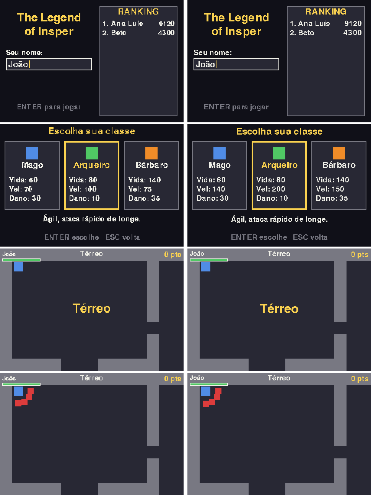

Depois vieram os sprites dos heróis, feitos pelo Thiago:

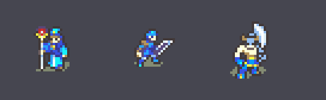

E, por fim, os inimigos animados, os golpes, a porta e a poção. O esqueleto passou por algumas versões até a final: primeiro de lado com espada, depois de frente, com o crânio redondo e as costelas:

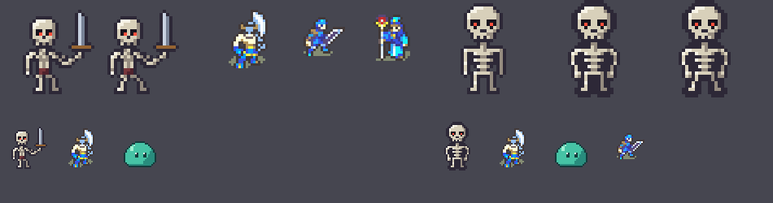

| Inimigos (versão final) | Golpes do Bárbaro | Porta fechada e aberta | Poção |
|---|---|---|---|
| 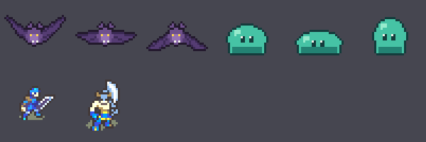 | 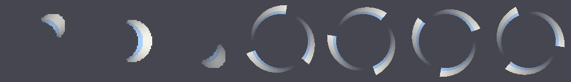 | 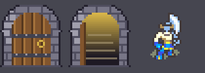 | 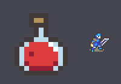 |

---

## Histórico

| Quando | O que aconteceu |
|---|---|
| 12/10 | Repositório criado, com o primeiro esboço da arquitetura. |
| 31/10 a 01/11 | Arquitetura modular definida em `docs/ARQUITETURA.md`. Backlog de 79 tasks criado no GitHub. |
| 02/11 a 08/11 | **Semana 1:** entrada pelo teclado, câmera, entidade, mapa de tiles, telas provisórias, personagem e nível. O herói anda pelo Térreo com a câmera seguindo. |
| 09/11 a 11/11 | **Semana 2:** IA de perseguição, projétil, ataques das três classes, pontuação, ranking e caixa de texto. |
| 12/11 | Combate completo. No mesmo dia, o professor pediu um código mais simples, e o jogo foi reescrito com herança simples (de 60 para 19 arquivos `.py`). |
| 13/11 a 14/11 | Pausa, tocador de som, músicas e efeitos, mapas da Biblioteca e do Topo, nome do jogador, quadro do ranking, inimigos no mapa, passagem de andar, vitória, derrota e tela de resultado. |
| 15/11 a 16/11 | Quadro de vida no HUD, zigue-zague do morcego, decisões do Dragão e suporte a sprites. |
| 17/11 | Sprites dos heróis, tiles de 32 pixels com pedra e biblioteca, música em cada tela, mapas compactos e o primeiro balanceamento. |
| 18/11 | Efeitos sonoros ligados, ícone do especial no HUD, poção de vida, knockback, sprites animados dos inimigos, flecha e bola de fogo, animação dos golpes do Bárbaro, porta de saída, tela cheia e ajustes no Mago e no Dragão. |
| 19/11 a 20/11 | Tasks de polimento (T80 a T85) e README da entrega. |
| 21/11 | Sprite do Dragão, aviso vermelho antes do anel de fogo, correção do sprite do Mago, tela de controles e docstrings em todo o código. |

O histórico completo está nos [commits](https://github.com/Dsoft-Pygame/The_Legend_of_Insper/commits/main) e nos [Pull Requests](https://github.com/Dsoft-Pygame/The_Legend_of_Insper/pulls?q=is%3Apr) do repositório.

---

## Decisões que tomamos

**1. Primeiro uma arquitetura muito modular, depois um código simples.** Começamos com uma arquitetura em camadas, com interfaces, classes abstratas, padrões de projeto (Comando, Estratégia, Fábrica), dados em JSON, lógica a 20 ticks por segundo com interpolação e testes com pytest. Ela permitia que três pessoas programassem ao mesmo tempo sem se atrapalhar, mas ficou grande demais para o tamanho do jogo e difícil de ler para quem estava aprendendo. A pedido do professor, o código foi reescrito com classes simples e herança com `super()`: de 60 arquivos e 3.934 linhas para 19 arquivos e 910 linhas, com o mesmo jogo funcionando. Os detalhes estão em [docs/SIMPLIFICACAO.md](docs/SIMPLIFICACAO.md).

**2. Tasks pequenas e explicadas.** Em vez de dividir o jogo em "partes grandes", quebramos tudo em tasks de 1 a 8 story points, cada uma com o passo a passo e o conceito novo que ensinava. Assim todo mundo conseguia pegar uma task e terminar, mesmo sem experiência com pygame.

**3. Funcionar primeiro, arte depois.** O jogo foi inteiro jogável com quadrados coloridos antes de ganhar sprites. Cada imagem que falta continua sendo desenhada como um quadrado colorido, então o jogo nunca quebra por falta de um arquivo.

**4. Tiles de 32 pixels.** Começamos com tiles de 16 pixels e resolução de Game Boy Advance (240 × 160). Os sprites novos dos heróis eram de 32 × 32, então o tile passou a ter 32 pixels e a tela interna dobrou para 480 × 320. Para o jogo continuar com a mesma sensação, tudo que era medido em pixels dobrou junto: tamanhos, velocidades, alcances e o HUD.

**5. Mapas compactos e menos inimigos.** Os primeiros mapas da Biblioteca e do Topo tinham inimigos demais (a Biblioteca chegou a ter 66, e nenhuma classe passava dela). Depois, com os tiles de 32 pixels, os andares ficaram grandes demais. Diminuímos os mapas e o número de inimigos na mesma proporção, para a dificuldade de cada andar continuar parecida.

**6. Balanceamento jogando.** Jogando as três classes, ajustamos os números: o Dragão começou com 600 de vida e terminou com 360, porque o Topo da Torre tem pilares e cantos que dificultam fugir dele; o Mago ficou mais lento e com menos dano; o Bárbaro ganhou vida e dano; os ataques passaram a empurrar os inimigos; e entrou a poção de vida, que começou com 15% de chance e terminou com 30%.

**7. Extras que ficaram de fora.** O planejamento tinha tasks opcionais de controle (gamepad), movimento em grade e dois jogadores no mesmo teclado. A simplificação tirou o suporte a controle que já existia, e o prazo final passou de 23/11 para 22/11, então priorizamos terminar e polir o jogo principal.

---

## Organização do código

O jogo é orientado a objetos: cada classe filha herda de uma mãe só, chama `super().__init__(...)` e troca só o que muda. Cada arquivo tem uma responsabilidade.

```
src/
├── main.py              ponto de entrada: cria a Aplicacao e roda
├── settings.py          cores, tamanhos, FPS, pontuação e a lista de andares
├── aplicacao.py         janela, loop principal e troca de tela
├── sons.py              toca os efeitos e as músicas pelo nome
├── ui.py                texto, caixa do nome, quadro do ranking e barras
├── telas/               tela inicial, escolha de classe, controles, jogo e resultado
├── jogo/                mapa, câmera, nível, pontuação e ranking
├── personagens/         entidade, personagem, heróis, inimigos, projéteis e poção
├── assets/              sprites, tiles e sons
└── data/
    ├── mapas/           um .txt por andar
    └── ranking.json     as partidas do ranking (fica fora do git)
```

```
Tela                      TelaInicial, TelaClasses, TelaControles, TelaJogo, TelaResultado
Entidade
├── Personagem
│   ├── Heroi             Mago, Arqueiro, Barbaro
│   └── Inimigo           Slime, Esqueleto, Morcego, Dragao
├── Projetil
│   └── Golpe
└── Pocao
```

Todo arquivo, classe e função tem uma **docstring** curta em português explicando o que faz.

A explicação completa, com o que acontece em cada quadro, está em [docs/ARQUITETURA.md](docs/ARQUITETURA.md).

---

## Créditos

- **Sprites dos heróis e do Dragão** (`src/assets/mago.png`, `arqueiro.png`, `barbaro.png` e `dragao.png`): Thiago A. Gomes.
- **Sons e músicas** (`src/assets/sons/`): gerados por código pelo Claude (assistente de IA da Anthropic) a pedido do grupo. Detalhes em [`src/assets/sons/CREDITOS.md`](src/assets/sons/CREDITOS.md).
- **Flecha, bola de fogo, poção, porta de saída, animações do slime, do morcego e do esqueleto, e os golpes do Bárbaro:** feitos pelo Claude (assistente de IA da Anthropic) a pedido do grupo.
- **Tiles de chão e parede** (`src/assets/tiles/`): pedra (Térreo e Topo da Torre) e biblioteca, 4 variantes de cada.
- **Vídeo de demonstração** (`docs/video/`): gravado pelo grupo; o corte e a trilha com as músicas do jogo foram feitos pelo Claude.
- **Uso de IA:** o grupo usou o Claude, da Anthropic, para ajudar na simplificação do código, nos sons e em parte da arte. Os commits feitos com a IA trazem a linha `Co-Authored-By: Claude` na mensagem.
