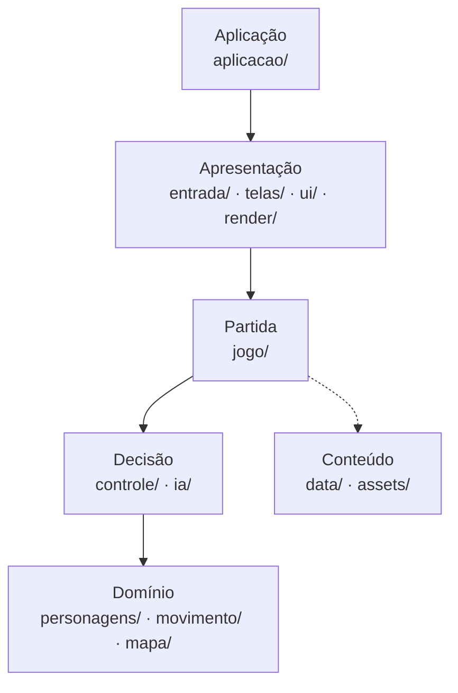
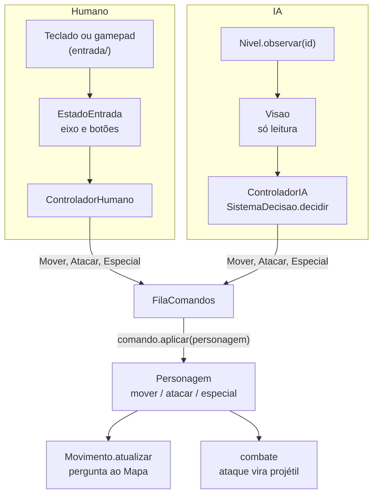
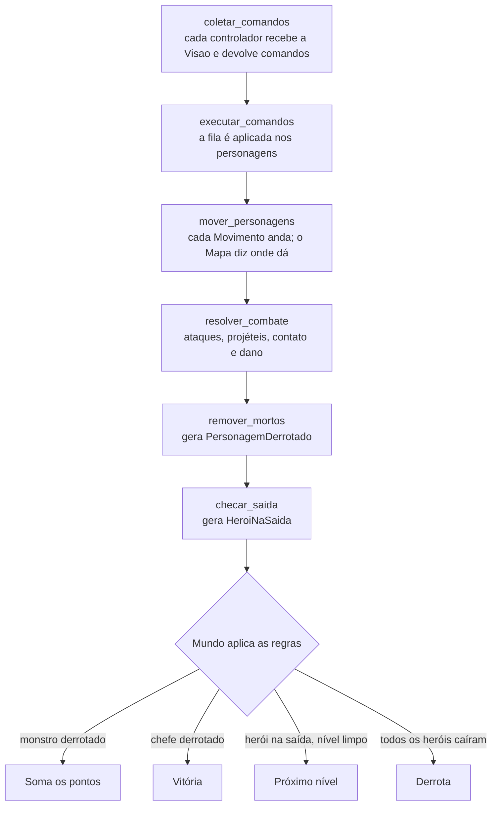
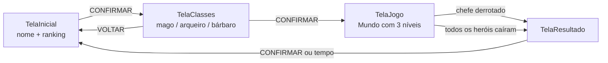

# Arquitetura

Este documento explica como o Legend of Insper está organizado: as camadas, o que cada pasta faz, como um comando sai do teclado (ou da IA) e chega no personagem, como um tick é processado e como as telas se encadeiam. Os arquivos `.py` já existem, mas só com o docstring do que vão conter; o código ainda vai ser escrito.

- Como trocar cada sistema (mapa, movimento, inimigo, IA, segundo jogador): [COMO_TROCAR.md](COMO_TROCAR.md).
- Formato dos arquivos de conteúdo: [src/data/README.md](../src/data/README.md).

O jogo: o jogador digita o nome (com o ranking ao lado), escolhe uma classe (Mago, Arqueiro ou Bárbaro) e entra no Mundo, que tem 3 níveis. Cada nível é um mapa maior que a tela, e a câmera segue os heróis, como nos Pokémon antigos. No último nível tem um chefe. Ganhando ou perdendo, a pontuação vai para o ranking. O tema (torre, Insper ou dungeon) ainda não foi decidido, então ele fica em dados.

## A ideia central

Cada sistema do jogo fica atrás de uma interface ou de um arquivo de dados, e pode ser trocado sem mexer no resto. Três ideias vêm direto da simulação lobo-coelho:

- **Entidade separada do sistema de decisão.** O `Personagem` só guarda estado e expõe ações (`mover`, `atacar`, `especial`). Quem decide o que ele faz é um `Controlador`: um humano (`ControladorHumano`) ou a IA (`ControladorIA` com um sistema de decisão de `ia/`). Herói e inimigo são a mesma classe, como o `Animal` serve para coelho e lobo.
- **Decidir antes, agir depois.** Os controladores não mexem no mundo: devolvem comandos, que vão para uma fila. Só depois que todos decidiram é que o `Nivel` aplica os comandos, como a `Simulacao` junta as `Acoes` antes de executar.
- **Camadas que só importam as de baixo.** O domínio não conhece janela, teclado nem desenho, como o domínio da simulação não conhece o SFML.

## Camadas



| Camada | Pastas | Responsabilidade | O que pode usar do pygame |
|---|---|---|---|
| Aplicação | `aplicacao/` | Loop principal, janela, troca de telas, sessão com os jogadores | Janela e relógio |
| Apresentação | `entrada/` | Teclado, controles e eventos | **Só aqui:** `pygame.event`, `pygame.key`, `pygame.joystick` |
| | `telas/`, `ui/`, `render/` | Telas, peças de tela e desenho do nível | `Surface`, desenho e fontes (nunca evento nem teclado) |
| Partida | `jogo/` | Mundo, nível, combate, fábrica, catálogo dos dados, pontuação, ranking | `Vector2` e `Rect` |
| Decisão | `controle/`, `ia/` | Quem manda nos personagens: controladores, comandos, fila, sistemas de decisão | `Vector2` |
| Domínio | `personagens/`, `movimento/`, `mapa/` | Estado das entidades, jeitos de andar, estrutura do mapa | `Vector2` e `Rect` |
| Conteúdo | `src/data/`, `src/assets/` | Classes, inimigos, temas, controles, aparências, mapas, arte | Nada (não é código) |

`settings.py` fica fora das camadas e guarda as cores RGB; qualquer camada pode importar. `pygame.Vector2` e `pygame.Rect` são matemática pura e funcionam sem janela, por isso o domínio pode usá-los.

### O que precisa continuar valendo

1. Só `entrada/` usa `pygame.event`, `pygame.key` e `pygame.joystick`. As telas recebem uma `EntradaMenu`, e os personagens recebem comandos.
2. O `Personagem` não importa nada de `entrada/`, `controle/` nem `ia/`. Ele satisfaz a interface `Ator` dos comandos só por ter os métodos certos.
3. Um sistema de decisão recebe só a `Visao`, devolve só comandos e tira toda a sorte do gerador que recebe.
4. Nada abaixo da Apresentação desenha. A entidade guarda uma chave de aparência, e o render decide a cor ou o sprite.
5. Nada de "jogador único": heróis, jogadores e dispositivos são sempre listas.
6. Conteúdo (números, tipos de inimigo, classes, níveis) mora em `src/data/`, não no código.

O teste `tests/test_camadas.py` confere as regras 1, 2 e 4 e a direção das camadas lendo os imports.

## Estrutura do repositório

```
The_Legend_of_Insper/
├── requirements.txt                 pygame
├── docs/
│   ├── README.md                    apresentação do projeto
│   ├── ARQUITETURA.md               este documento
│   └── COMO_TROCAR.md               guia de troca de cada sistema
├── tests/
│   └── test_camadas.py              confere as regras das camadas
└── src/
    ├── main.py                      ponto de entrada: cria a Aplicacao e executa
    ├── settings.py                  cores RGB
    ├── aplicacao/
    │   ├── aplicacao.py             loop principal e troca de telas
    │   └── sessao.py                Sessao e PerfilJogador (lista de jogadores)
    ├── entrada/                     ÚNICA pasta com pygame.event, pygame.key, pygame.joystick
    │   ├── leitor_entrada.py        o único pygame.event.get() do jogo
    │   ├── entrada_menu.py          AcaoMenu, EntradaMenu, EntradaQuadro
    │   ├── teclado.py               DispositivoTeclado (WASD, setas)
    │   ├── gamepad.py               DispositivoGamepad
    │   └── gerenciador_dispositivos.py   quais dispositivos existem e quem usa cada um
    ├── telas/
    │   ├── tela.py                  classe base de todas as telas
    │   ├── tela_inicial.py          nome do jogador + ranking
    │   ├── tela_classes.py          escolha da classe
    │   ├── tela_jogo.py             monta os heróis e o Mundo, desenha
    │   └── tela_resultado.py        vitória/derrota, pontos, salva no ranking
    ├── ui/
    │   ├── caixa_texto.py           campo do nome
    │   ├── painel_ranking.py        lista do ranking
    │   ├── cartao_classe.py         cartão de cada classe
    │   └── hud.py                   vidas, pontos, nível, chefe
    ├── render/                      ÚNICA pasta que desenha o mundo
    │   ├── camera.py                recorte do mapa que aparece na tela
    │   ├── aparencias.py            chave de aparência → cor ou sprite
    │   └── renderizador_nivel.py    desenha mapa e entidades pela câmera
    ├── jogo/
    │   ├── mundo.py                 níveis em sequência, vitória e derrota, passo fixo
    │   ├── nivel.py                 o tick de um nível
    │   ├── combate.py               ataques, projéteis, colisões e dano
    │   ├── eventos.py               PersonagemDerrotado, HeroiNaSaida
    │   ├── fabrica.py               monta personagens e controladores a partir dos dados
    │   ├── catalogo.py              lê e confere src/data/ ao abrir o jogo
    │   ├── pontuacao.py             pontos da partida
    │   └── ranking.py               lê e salva o ranking em JSON
    ├── controle/
    │   ├── dispositivo.py           Botao, EstadoEntrada, interface DispositivoEntrada
    │   ├── comandos.py              Ator, Comando, Mover, Atacar, Especial
    │   ├── fila_comandos.py         FilaComandos
    │   ├── controlador.py           Controlador (base)
    │   ├── controlador_humano.py    dispositivo → comandos
    │   └── controlador_ia.py        sistema de decisão → comandos
    ├── ia/
    │   ├── sistema_decisao.py       interface SistemaDecisao
    │   ├── decisao_perseguir.py     slime, esqueleto
    │   ├── decisao_zigue_zague.py   morcego
    │   ├── decisao_chefe.py         chefe em duas fases
    │   └── registro.py              nome no JSON → classe
    ├── personagens/
    │   ├── tipos.py                 EntidadeId, Lado
    │   ├── entidade.py              base: id, posição, tamanho, aparência
    │   ├── personagem.py            herói, inimigo e chefe (uma classe só)
    │   ├── projetil.py              flechas, bolas de fogo, golpes
    │   ├── visao.py                 o que um personagem enxerga
    │   ├── classe_heroi.py          classe jogável, como dado
    │   └── ataques/                 Ataque, AtaqueProjetil, AtaqueGolpe, registro
    ├── movimento/
    │   ├── movimento.py             interfaces Corpo e Movimento
    │   ├── movimento_livre.py       top-down contínuo (padrão)
    │   ├── movimento_grade.py       tile a tile, estilo Pokémon
    │   └── registro.py
    ├── mapa/
    │   ├── mapa.py                  interfaces Mapa e CarregadorMapa
    │   ├── mapa_tiles.py            grade de tiles 16×16
    │   ├── carregador_texto.py      lê src/data/mapas/*.txt
    │   └── registro.py
    ├── assets/                      sprites, tilesets, sons e fontes
    └── data/                        conteúdo do jogo (formato em data/README.md)
```

## Principais classes

| Classe | Arquivo | Papel |
|---|---|---|
| `Aplicacao` | `aplicacao/aplicacao.py` | Abre a janela, roda o loop e guarda a tela ativa, o catálogo, o ranking e a sessão. |
| `Sessao`, `PerfilJogador` | `aplicacao/sessao.py` | Lista de jogadores (nome, dispositivo, classe). Co-op = mais um perfil. |
| `LeitorEntrada` | `entrada/leitor_entrada.py` | Lê os eventos do pygame uma vez por quadro e devolve dados simples. |
| `DispositivoTeclado`, `DispositivoGamepad` | `entrada/` | Leem teclas ou botões e devolvem um `EstadoEntrada`. |
| `GerenciadorDispositivos` | `entrada/gerenciador_dispositivos.py` | Sabe quais dispositivos existem e quem está usando cada um. |
| `Tela` | `telas/tela.py` | Molde das telas: `tratar_entrada`, `atualizar` e `desenhar`. |
| `RenderizadorNivel`, `Camera`, `Aparencias` | `render/` | Desenham o nível pela câmera, só lendo o estado. |
| `Mundo` | `jogo/mundo.py` | Partida: níveis em sequência, lista de heróis, passo fixo, regras de vitória e derrota. |
| `Nivel` | `jogo/nivel.py` | Um nível em andamento: personagens e controladores por id, projéteis, fila, o tick. |
| `Fabrica`, `Catalogo` | `jogo/` | Leem os dados e montam personagens e controladores. |
| `Controlador` | `controle/controlador.py` | Base de quem manda num personagem: `gerar_comandos(visao)`. |
| `ControladorHumano` | `controle/controlador_humano.py` | Dispositivo → comandos. Serve para teclado e controle. |
| `ControladorIA` | `controle/controlador_ia.py` | Sistema de decisão → comandos, com sorte determinística. |
| `Mover`, `Atacar`, `Especial` | `controle/comandos.py` | Pedidos de ação, guardados como dado. |
| `FilaComandos` | `controle/fila_comandos.py` | Os pedidos do tick, aplicados depois que todos decidiram. |
| `SistemaDecisao` | `ia/sistema_decisao.py` | Interface das IAs: `decidir(visao, gerador)`. |
| `Personagem` | `personagens/personagem.py` | Herói, inimigo ou chefe: estado + ações. Não lê input, não decide, não desenha. |
| `Projetil` | `personagens/projetil.py` | Tudo que dá dano, inclusive o golpe corpo a corpo (projétil parado). |
| `Visao` | `personagens/visao.py` | Retrato só de leitura do que um personagem enxerga. |
| `ClasseHeroi` | `personagens/classe_heroi.py` | Classe jogável como dado (vem de `classes.json`). |
| `Ataque` | `personagens/ataques/ataque.py` | Estratégia de ataque, compartilhada entre heróis e inimigos. |
| `Movimento` | `movimento/movimento.py` | Estratégia de andar: `MovimentoLivre`, `MovimentoGrade`. |
| `Mapa`, `CarregadorMapa` | `mapa/mapa.py` | Estrutura do nível atrás de uma interface: colisão, surgimentos, saída. |

### Herança e composição

```mermaid
classDiagram
    <<interface>> DispositivoEntrada
    <<interface>> SistemaDecisao
    <<interface>> Movimento
    <<interface>> Ataque
    <<interface>> Mapa

    Tela <|-- TelaInicial
    Tela <|-- TelaClasses
    Tela <|-- TelaJogo
    Tela <|-- TelaResultado
    Controlador <|-- ControladorHumano
    Controlador <|-- ControladorIA
    Entidade <|-- Personagem
    Entidade <|-- Projetil

    ControladorHumano o-- DispositivoEntrada : lê
    ControladorIA o-- SistemaDecisao : pergunta
    Personagem o-- Movimento : anda com
    Personagem o-- Ataque : ataca com
    Mundo *-- Nivel : um de cada vez
    Nivel o-- Mapa
    Nivel *-- Personagem : por id
    Nivel *-- Controlador : por id
    Nivel *-- Projetil
    Nivel *-- FilaComandos
```

Quase tudo que é trocável é **composição**: o personagem **tem** um movimento, um ataque e um especial; o nível **tem** um controlador para cada personagem; o controlador de IA **tem** um sistema de decisão. Trocar um deles é entregar outro objeto que cumpre a mesma interface. Herança fica só onde há um molde comum de verdade (`Tela`, `Controlador`, `Entidade`).

## Do input à ação



1. O dispositivo do jogador (uma parte do teclado ou um controle) é lido e vira um `EstadoEntrada`: um eixo de -1 a 1 e os botões apertados. Nada de pygame passa daqui.
2. O `ControladorHumano` transforma isso em comandos: eixo → `Mover(eixo)`, botão de ataque → `Atacar()`, botão de especial → `Especial()`.
3. Para um inimigo, o `Nivel` monta a `Visao` dele e o `ControladorIA` pergunta ao sistema de decisão, que devolve comandos do mesmo tipo.
4. Todos os comandos vão para a mesma `FilaComandos`, com o id do personagem.
5. O `Nivel` esvazia a fila e chama `comando.aplicar(personagem)`. O personagem só registra a intenção; o movimento e o combate a resolvem no mesmo tick.

O personagem nunca sabe quem pediu. Por isso um herói pode ir para o piloto automático (`ControladorIA`) e um jogador pode controlar um inimigo (`ControladorHumano`), só trocando o controlador. Um replay ou um jogo em rede seriam mais dois controladores.

Nos menus, o `LeitorEntrada` transforma teclas e botões em ações (`CIMA`, `BAIXO`, `CONFIRMAR`, `VOLTAR`, `APAGAR`) e texto digitado, e é só isso que as telas recebem.

## Controle de tempo

`Aplicacao.executar` roda um loop com estes passos por quadro:

1. `leitor_entrada.ler_quadro()` lê os eventos; fechar a janela encerra.
2. `dispositivos.atualizar(...)` trata controles ligados e desligados.
3. `tela_atual.tratar_entrada(...)` recebe as ações de menu.
4. `tela_atual.atualizar(dt)`, com o tempo real desde o quadro anterior.
5. `tela_atual.desenhar(...)` numa superfície pequena (240×160, resolução de GBA), ampliada para a janela.

Durante a partida, a `TelaJogo` chama `mundo.tempo_avancar(dt)`, que usa o mesmo **passo fixo com acumulador** do `Simulacao::tempo_avancar`:

```
tempo_acumulado += dt              (limitado a 0,25 s por quadro)
enquanto tempo_acumulado >= PASSO: (PASSO = 1/60 s)
    tick_atualizar()
    tempo_acumulado -= PASSO
```

Cada tick representa sempre o mesmo tempo, em PC rápido ou lento. Junto com a sorte determinística da IA (um gerador por semente, tick e id, como na simulação), a mesma sequência de comandos sempre produz a mesma partida.

## Ciclo de um tick

`Nivel.tick_atualizar(dt, tick)` executa as etapas abaixo, sempre nesta ordem, e devolve os eventos para o `Mundo`:



Na etapa de coleta ninguém altera o mundo: todos decidem olhando o mesmo estado. O `Nivel` não soma pontos nem decide vitória; ele só devolve eventos, como o `matar_animais` da simulação devolve a lista de mortos, e o `Mundo` aplica as regras.

Depois do tick, o `RenderizadorNivel` desenha o estado como ficou e o `Hud` vai por cima.

## Mundo, níveis e câmera

O `Mundo` é criado pela `TelaJogo` com a lista de heróis (um por jogador da `Sessao`) e o tema escolhido. Ele joga um nível de cada vez:

- os heróis passam de um nível para o outro com a vida que sobrou;
- nos níveis 1 e 2, a saída abre quando todos os inimigos caem, e um herói encostando nela leva ao próximo nível;
- no nível 3 está o chefe, e derrotá-lo vence a partida;
- se todos os heróis caírem, a partida acaba em derrota.

Cada nível tem um `Mapa` maior que a tela, criado pelo carregador que o tema indica (hoje, um mapa de texto em `src/data/mapas/`). A tela do jogo mostra só um recorte, e quem decide qual é a `Camera`, que agora mora no render:

- a cada quadro, `camera.seguir(...)` centraliza o recorte no ponto médio dos heróis vivos (com um jogador, é ele);
- perto das bordas do mapa, a câmera para e quem anda na tela é o herói;
- tudo que é desenhado dentro do nível passa por `camera.para_tela(...)`;
- o `Hud` não usa a câmera, porque fica sempre fixo na tela.

## Fluxo de telas



Os dados da partida ficam na `Sessao`: a `TelaInicial` cria o perfil do jogador (nome e dispositivo), a `TelaClasses` grava a classe, o `Mundo` soma os pontos na `Pontuacao` e a `TelaResultado` lê tudo para salvar no ranking.

## Co-op local: o que já está preparado

O co-op não está implementado, mas nada no desenho supõe um jogador só:

- a `Sessao` guarda uma lista de `PerfilJogador`, cada um com o seu dispositivo;
- o teclado vira dois dispositivos (WASD e setas), e cada controle conectado vira mais um;
- a `TelaJogo` cria um herói e um `ControladorHumano` para cada perfil;
- o `Mundo` guarda uma lista de heróis, e a derrota é quando todos caem;
- a câmera segue o centro dos heróis vivos, e o HUD desenha uma barra por herói;
- a IA persegue o herói mais próximo, seja qual for;
- a `EntradaMenu` diz de qual dispositivo veio cada ação, para cada jogador navegar o próprio menu.

O que falta para ligar o co-op está em [COMO_TROCAR.md](COMO_TROCAR.md#adicionar-o-segundo-jogador-co-op-local).

## Pontuação

- cada inimigo derrotado vale os seus pontos (definidos em `inimigos.json`, ideia: 50 a 100);
- nível concluído: 500; chefe derrotado: 2000;
- só se vencer: bônus por terminar rápido e pela vida que sobrou.

Perdendo, o que foi somado até ali vai para o ranking do mesmo jeito. No co-op a pontuação é uma só, e cada `PersonagemDerrotado` já diz quem deu o último golpe, caso um dia valha pontuar por jogador.

## Ordem sugerida para implementar

Cada etapa termina com o jogo abrindo e algo novo funcionando.

1. **Base:** `main.py`, `Aplicacao`, `LeitorEntrada`, `EntradaMenu`, `Tela` e as quatro telas com navegação simples. Roda: digitar o nome e passar por todas as telas.
2. **Mapa e desenho:** `Mapa`, `MapaTiles`, `CarregadorTexto`, um mapa em `src/data/mapas/`, `Camera`, `Aparencias` e `RenderizadorNivel`. Roda: o nível aparece na tela de jogo.
3. **Herói controlado:** `Personagem`, `MovimentoLivre`, comandos, fila, `ControladorHumano`, `DispositivoTeclado` e o começo do `Nivel`. Roda: andar pelo mapa com a câmera seguindo.
4. **Combate e classes:** ataques, `Projetil`, `combate.py`, `classes.json`, `Catalogo`, `Fabrica`. Roda: atacar com as três classes.
5. **Inimigos e IA:** `ia/`, `ControladorIA`, `inimigos.json`, dano e mortes. Roda: um nível jogável.
6. **Mundo e chefe:** `temas.json`, três níveis em sequência, saída, `DecisaoChefe`, vitória e derrota.
7. **Pontos e ranking:** `Pontuacao`, `Ranking`, `PainelRanking`, `Hud` e `TelaResultado`.
8. **Extras:** `MovimentoGrade`, `DispositivoGamepad`, `GerenciadorDispositivos` completo e o `tests/test_camadas.py`.

## Divisão sugerida do grupo

| Pessoa | Pastas |
|---|---|
| 1 | `aplicacao/`, `entrada/`, `telas/` |
| 2 | `ui/`, `render/` |
| 3 | `personagens/`, `movimento/`, `controle/`, `ia/` |
| 4 | `jogo/`, `mapa/`, `src/data/` |

As interfaces (`DispositivoEntrada`, `Comando`, `Controlador`, `SistemaDecisao`, `Movimento`, `Ataque`, `Mapa`) são o combinado entre as pessoas: cada uma pode trabalhar na sua pasta sabendo exatamente o que recebe e o que entrega.

## Observações

- Python 3.10 ou mais novo (as anotações usam `X | None` e `@dataclass(slots=True)`).
- As pastas não têm `__init__.py`. No Python 3 isso não é obrigatório para importar (`from personagens.personagem import Personagem` funciona rodando `python src/main.py`).
- Interfaces usam `typing.Protocol` quando qualquer classe com os métodos certos serve (dispositivo, comando, decisão, movimento, ataque, mapa) e `abc.ABC` quando há uma base para herdar (`Tela`, `Controlador`).
- Os mapas começam como texto escrito à mão e podem passar a vir do [Tiled](https://www.mapeditor.org/) com um carregador novo, sem mudar o resto.
